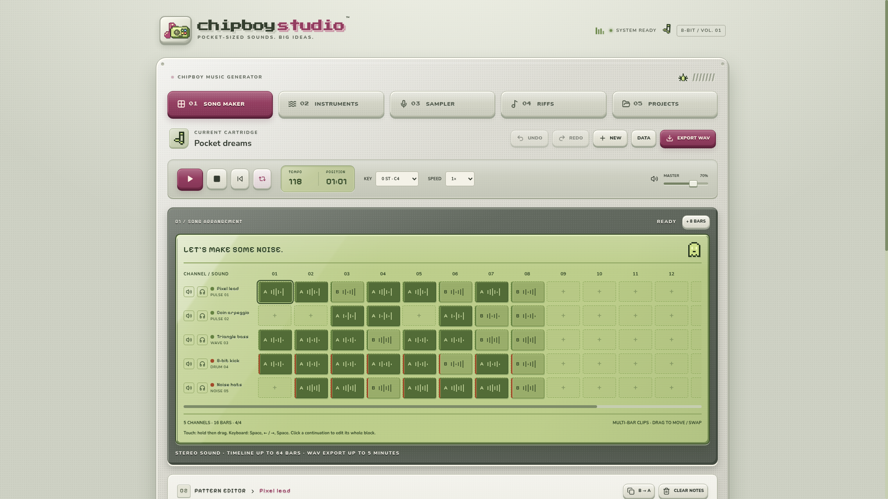
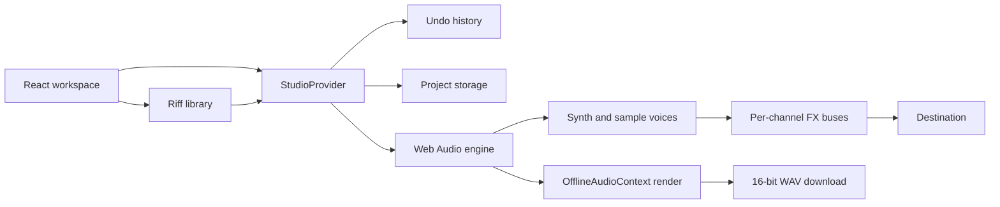

# Chipboy Studio

**A pocket-sized chiptune studio that runs entirely in your browser.**

[](https://github.com/ones-is-lord/chipboy-studio/actions/workflows/ci.yml)
[](https://github.com/ones-is-lord/chipboy-studio/actions/workflows/deploy-pages.yml)
[](LICENSE)
[](https://react.dev)
[](https://developer.mozilla.org/docs/Web/API/Web_Audio_API)



Chipboy Studio is a complete little music workstation: a 16-step sequencer, a piano roll, 30 synth presets, a microphone sampler with a slicer and 16 pads, project slots, share links and offline WAV export. No account. No server. No samples uploaded anywhere.

Built with React 19, TypeScript, Vite, Tailwind CSS and the Web Audio API. Styled like a very good 1990s handheld that never existed.

## Contents

- [Features](#features)
- [Quick start](#quick-start)
- [Scripts](#scripts)
- [Keyboard shortcuts](#keyboard-shortcuts)
- [How it works](#how-it-works)
- [Project files and privacy](#project-files-and-privacy)
- [Browser support](#browser-support)
- [Deployment](#deployment)
- [Testing and quality](#testing-and-quality)
- [Documentation](#documentation)
- [Contributing](#contributing)
- [License and credits](#license-and-credits)

## Features

### Song maker

- Five channels per song, 16 bars by default, up to 64 bars.
- Two patterns per channel. Matching blocks share a pattern; duplicate a block to edit an independent copy.
- Multi-bar clips from 1 to 8 bars, with drag-to-move and drag-to-swap arrangement editing.
- Tempo from 40 to 240 BPM, speed from 0.25x to 2x, 4/4, and a song-wide key transpose from −12 to +12 semitones.
- Per-channel volume, pitch, pan, mute and solo, plus reverb and delay sends and a master volume.
- Undo and redo across musical edits.
- Transport with play, pause, stop and return-to-start.

### Pattern editor

- Step pads or a piano roll with a five-octave keyboard.
- Draw notes, drag them, resize their length and copy patterns between A and B.
- Trim, stretch, repeat or remove a block. Sample blocks follow the sample's loop mode.
- Channel octave transposition without touching note data.

### Riff library

- 30 built-in one-bar riffs across drum loops, basslines, melodies, chords/arps and FX.
- Audition any riff at the current song tempo, then stamp it into the selected channel and pattern in one click.
- Stamping switches the channel to the riff's instrument and root note while keeping the channel name; sample channels keep their audio and fit the riff by octave.
- Capture the selected pattern as a named custom riff. Up to 40 custom riffs live in browser storage.
- Category filters, a 16-step mini-grid on every card, and a delete action for custom riffs.

### Instruments

- 30 original presets across chiptune, synths, bass, keys and drums.
- Preview any preset, assign it to the selected channel or add a new channel.
- Waveform previews generated from the same parameters used by the audio engine.

### Sampler

- Import WAV, MP3, OGG and other browser-decodable audio; up to 50 MB and two minutes per file.
- Record from the microphone for up to 60 seconds.
- Waveform selection with crop, normalize, reverse, fade in, fade out and gain.
- Equal or transient slicing into 2, 4, 8 or 16 slices.
- 16 keyboard-mapped pads, each assignable to a sample and playable live.
- Assign a sample to a channel and place it in the arrangement as pitched or looped audio.

### Projects

- Up to 30 named slots in `localStorage`, with autosave for the current session.
- Export and import `.chipboy.json` files. The importer accepts Chipboy Studio v3, v4 and v5 files.
- Share links carry song data in the URL fragment-free `project` query parameter; no upload is involved.
- Download a stereo 16-bit WAV of the arrangement, up to five minutes.
- Clear warnings when a project references sample audio that is not in the current browser session.

### Interface

- Five workspaces: Song maker, Instruments, Sampler, Riffs and Projects.
- SNES-style pixel-art controller overlaid on a music note, with high-contrast outlines, animated sprites and a blinking power LED.
- SNES-inspired textured plastic shell and bezels, a glass-like highlight across the screen, and chunky bevelled hardware controls with extra-bold labels that fit every button size.
- Self-hosted pixel fonts (Press Start 2P and Pixelify Sans) and a rounded body font (Nunito). No Google Fonts request at runtime.
- Bolder pixel typography with layered letter shadows, scanline and glass-sheen overlays, LCD readouts and a reduced-motion mode that respects `prefers-reduced-motion`.
- Responsive layout, keyboard navigation and visible focus states.
- Installable web app manifest and social preview image.

## Quick start

Requirements: **Node.js 20.19+** and **pnpm 12** (the repository declares `packageManager`).

```bash
git clone https://github.com/ones-is-lord/chipboy-studio.git
cd chipboy-studio
corepack enable
pnpm install
pnpm dev
```

Open <http://localhost:8080>. The first tap or keypress starts the Web Audio context, as required by browsers.

If `corepack enable` is blocked by permissions, run commands through Corepack directly:

```bash
corepack pnpm install
corepack pnpm dev
```

To let a container or tunnel host reach the dev server, pass the hostnames explicitly:

```bash
VITE_ALLOWED_HOSTS=my-preview.example.com pnpm dev
```

## Scripts

| Command | What it does |
| --- | --- |
| `pnpm dev` | Start the Vite dev server on port 8080. |
| `pnpm build` | Type-check and build the production bundle into `dist/`. |
| `pnpm preview` | Serve the production build locally. |
| `pnpm lint` | Run ESLint over the repository. |
| `pnpm lint:fix` | Apply ESLint's safe fixes. |
| `pnpm typecheck` | Run TypeScript with `--noEmit`. |
| `pnpm test` | Run the Vitest suite once. |
| `pnpm test:watch` | Run Vitest in watch mode. |
| `pnpm check` | Lint, type-check, test and build in one command. This is what CI runs. |

Regenerate the favicon, app icons and social image after changing the pixel artwork:

```bash
python3 -m pip install pillow
curl -sL -o /tmp/fonts/PressStart2P-Regular.ttf \
  https://github.com/google/fonts/raw/main/ofl/pressstart2p/PressStart2P-Regular.ttf
python3 scripts/generate-icons.py /tmp/fonts/PressStart2P-Regular.ttf
```

## Keyboard shortcuts

| Keys | Action |
| --- | --- |
| `Space` | Play or pause the song. In arrangement focus, pick up or drop a block. |
| `←` / `→` | Move the selected arrangement block by one bar. |
| `Escape` | Cancel an arrangement move. |
| `1`–`4`, `Q`–`R`, `A`–`F`, `Z`–`V` | Trigger the 16 sampler pads. |
| `Delete` / `Backspace` | Delete the selected note in the piano roll. |
| `Cmd/Ctrl + Z` | Undo. |
| `Cmd/Ctrl + Shift + Z` or `Ctrl + Y` | Redo. |

## How it works



The song is plain serializable state. Playback converts arrangement blocks into timed note events, schedules them on a `BaseAudioContext`, and the same scheduling code runs against an `OfflineAudioContext` for WAV export. The sampler keeps decoded `AudioBuffer` objects in memory only; project files and browser storage keep sample metadata and a `sampleId`, never raw audio.

Read [docs/ARCHITECTURE.md](docs/ARCHITECTURE.md) for module boundaries, the audio graph and the state flow. Read [docs/MUSIC-GENERATOR.md](docs/MUSIC-GENERATOR.md) for the research behind the riff library and mixer. Read [docs/PROJECT_FORMAT.md](docs/PROJECT_FORMAT.md) for the file schema.

## Project files and privacy

- **No audio leaves the browser.** Imports are decoded locally. Share links contain note and arrangement data only.
- **Microphone access is opt-in.** The browser asks for permission the first time you press Record. `Permissions-Policy` on the deployment allows microphone access for this origin only.
- **Local projects are not backups.** `localStorage` can be cleared by the browser, private windows or site-data settings. Export JSON for anything you care about.
- **Sample audio is session-only.** After importing a project on another device, re-import its sample WAV files. The Projects screen lists channels that need attention.
- **Share links are not encrypted.** Anyone with the link can read the song data. Do not put private information in a song name.

The project file format is documented and validated with Zod on import. Invalid or oversized files are rejected with a readable error instead of partially loading.

## Browser support

Chipboy Studio targets current evergreen browsers with Web Audio, `AudioContext`, `OfflineAudioContext`, `MediaRecorder` and ES2020 modules.

| Browser | Playback | Export | Sampler import | Microphone |
| --- | --- | --- | --- | --- |
| Chrome / Edge (recent) | Yes | Yes | Yes | Yes |
| Firefox (recent) | Yes | Yes | Yes | Yes |
| Safari 16.4+ | Yes | Yes | Yes | Yes, after a user gesture |
| Mobile Safari / Chrome | Yes | Yes | Yes | Yes, where the OS permits |

`MediaRecorder` support varies on older mobile browsers. Importing a WAV file is always available as a fallback.

## Deployment

The build is a static SPA. Any static host works. The repository includes:

- `vercel.json` with SPA rewrites, cache headers and a restrictive Content Security Policy.
- `public/_headers` with the same policy for Netlify and compatible hosts.
- `.github/workflows/deploy-pages.yml` for GitHub Pages.

For Vercel, import the repository and keep the default build command `pnpm build` and output directory `dist`. For Netlify, use the same command and directory; `public/_headers` is copied into the build. For GitHub Pages, enable **Settings → Pages → Source: GitHub Actions** and run the deploy workflow; it sets `VITE_BASE_PATH` to the repository name and adds a `404.html` fallback.

See [docs/DEPLOYMENT.md](docs/DEPLOYMENT.md) for custom domains, base paths, headers and troubleshooting.

## Testing and quality

```bash
pnpm check
```

The suite covers song timing and arrangement helpers, project normalization and storage, share-link encoding, riff validity and custom-riff storage, transpose and solo behavior, WAV headers and sample quantization, sample processing, effect tails, instrument metadata and event scheduling. Audio tests use a small `AudioBuffer` polyfill so the real processing code runs under Node.

The CI workflow runs the same command on every push and pull request, plus a production build. Dependabot keeps npm and GitHub Actions dependencies current.

## Documentation

- [Architecture](docs/ARCHITECTURE.md)
- [Inspired by MTV Music Generator](docs/MUSIC-GENERATOR.md)
- [Project file format](docs/PROJECT_FORMAT.md)
- [Development guide](docs/DEVELOPMENT.md)
- [Deployment guide](docs/DEPLOYMENT.md)
- [Release guide](docs/RELEASING.md)
- [Contributing](CONTRIBUTING.md)
- [Code of conduct](CODE_OF_CONDUCT.md)
- [Security policy](SECURITY.md)
- [Changelog](CHANGELOG.md)

## Contributing

Issues and pull requests are welcome. Start with [CONTRIBUTING.md](CONTRIBUTING.md), keep changes focused, and run `pnpm check` before opening a pull request. For security reports, follow [SECURITY.md](SECURITY.md) instead of opening a public issue.

## License and credits

Released under the [MIT License](LICENSE).

Fonts: [Press Start 2P](https://fonts.google.com/specimen/Press+Start+2P) by CodeMan38, [Pixelify Sans](https://fonts.google.com/specimen/Pixelify+Sans) by Stefie Justprince, and [Nunito](https://fonts.google.com/specimen/Nunito) by Vernon Adams, all under the SIL Open Font License. Icons are drawn as pixel art in this repository. Built with [React](https://react.dev), [Vite](https://vite.dev), [Tailwind CSS](https://tailwindcss.com) and the [Web Audio API](https://developer.mozilla.org/docs/Web/API/Web_Audio_API).

Chipboy Studio is an independent project. It is not affiliated with Nintendo or any console manufacturer.
