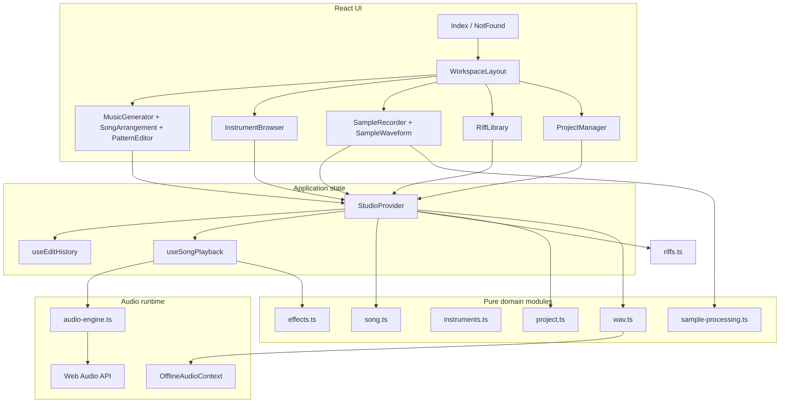
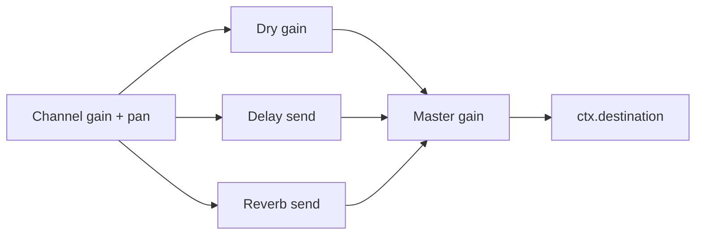
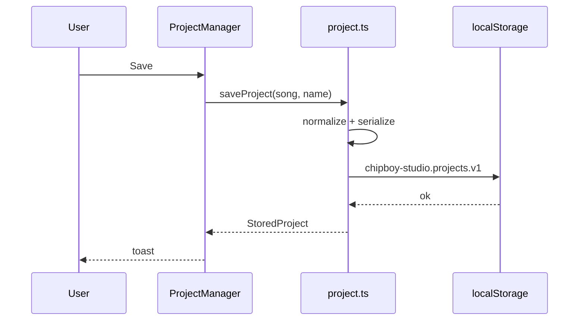

# Architecture

Chipboy Studio is a static single-page application. There is no backend, no authentication and no network request after the bundle loads. Everything runs on the user's device.

## Shells

The same `dist/` bundle ships in three forms:

| Shell | What it adds |
| --- | --- |
| Web | Vite build served by any static host. |
| PWA | `vite-plugin-pwa` service worker precaches the app shell for offline use and install. |
| Android | Capacitor project in `android/` bundles `dist/` in the APK and adds native share, haptics, status bar, splash screen and microphone permission. |

`src/lib/native.ts` is the only module that imports Capacitor plugins. It exposes `initNativeShell`, `saveBlob`, `shareLink` and `tapHaptic`, and falls back to browser behavior when `Capacitor.isNativePlatform()` is false. Components never import native plugins directly.

The Android build flow is:

```text
src/ -> vite build -> dist/ -> cap sync android -> android/app/src/main/assets/public/ -> Gradle -> APK
```

The APK does not use the service worker or the network. It loads the bundled assets from Capacitor's local WebView origin.

## Layers



### UI shell

- `src/App.tsx` owns the error boundary, tooltip provider, toast host and the tiny base-path route check.
- `src/pages/Index.tsx` renders the studio and sets the page title.
- `src/pages/NotFound.tsx` is a friendly 404 that keeps the console look. It uses a plain anchor, so the app needs no router dependency.
- `src/components/WorkspaceLayout.tsx` is the hardware shell: brand, status strip, five mode tabs, transport and footer. Inactive modes stay mounted with `hidden` so audio state, unsaved edits and scroll positions survive tab changes.
- `src/components/ErrorBoundary.tsx` catches render errors and offers a reload instead of a blank screen.

### State

`StudioProvider` is the single source of truth for the current song, selected channel and block, sample library, project metadata and playback. It exposes a `useStudio()` hook.

| Concern | Implementation |
| --- | --- |
| Song edits | `history.edit(next)` through `useEditHistory` |
| Undo/redo | Snapshot history with a 100-entry cap and keyboard shortcuts |
| Autosave | Debounced `saveAutosave` after edits |
| Shared songs | `readSharedSong` on first mount, then `history.edit` |
| Project load | `loadSong` normalizes and replaces the song |
| Playback | `useSongPlayback` owns the `AudioContext` and schedules events |
| Sample library | In-memory `SampleAsset[]`, each with a decoded `AudioBuffer` |

The song object is intentionally plain data: strings, numbers, arrays and booleans. `AudioBuffer` objects never enter the song. A track refers to sample audio with `sampleId`.

### Domain modules

- `src/lib/song.ts` — song, track, block and note types plus timing and arrangement helpers. No React, no Web Audio.
- `src/lib/project.ts` — Zod schemas, normalization, versioned file parsing, share-link encoding and `localStorage` access. No React.
- `src/lib/instruments.ts` — the 30 preset definitions, channel factory and category colours.
- `src/lib/riffs.ts` — the built-in riff library, custom-riff storage, preview-track factory and octave fitting.
- `src/lib/sample-processing.ts` — crop, normalize, reverse, fade, gain, slice points and pitch-preserving stretch.
- `src/lib/effects.ts` — effect defaults, tail calculation and the shared delay/reverb bus.
- `src/lib/wav.ts` — RIFF/WAVE encoding, blob download and filename sanitizing.
- `src/lib/audio-engine.ts` — voice scheduling, event generation and offline rendering.

Pure modules are unit-tested without a browser. Tests that need audio use a minimal `AudioBuffer` polyfill in `src/test/setup.ts`.

## Audio graph



`createEffectsBus` builds one bus per channel for each playback or render. Each scheduled voice connects to its channel bus. Live playback builds these buses when play starts, so reverb and delay sends are audible during playback and in WAV export. Pan is applied per voice with a `StereoPannerNode`, so pan changes take effect on the next scheduled note.

### Live playback

`useSongPlayback` creates an `AudioContext` on the first play action (browser autoplay rules). `songEvents(song)` flattens arrangement blocks into `{ track, trackIndex, note, start, duration, block }` events, applies the song transpose and filters muted or non-soloed channels. A look-ahead timer schedules events slightly before their start time. Each event calls `scheduleVoice`, which chooses a synth or sample voice based on the track and routes it to that channel's effect bus.

The transport position is derived from `ctx.currentTime` and the song's `stepSeconds`, not from a `setInterval` counter. That keeps the readout stable when the tab is throttled.

### WAV export

`renderSong` uses an `OfflineAudioContext` with the same scheduling function and effect bus. Rendering is capped at five minutes to keep memory bounded. `wavBytes` writes a stereo 16-bit PCM file without normalizing quiet material upward; clipping samples are attenuated instead.

### Sample voices

`prepareSample` resolves the sample asset for a track and note. It picks the playback rate from the note's MIDI distance to the sample's `rootMidi`, applies the channel pitch offset and honors loop mode and block length. The sample cache avoids re-decoding a buffer for every note.

## Persistence



Storage keys:

- `chipboy-studio.projects.v1` — saved slots (maximum 30).
- `chipboy-studio.autosave.v1` — the latest autosave.
- `chipboy-studio.riffs.v1` — custom riffs (maximum 40).

Every read is validated and normalized. A corrupt slot is skipped, not fatal. `localStorage` quota errors surface as a readable message.

## Error handling

- `ErrorBoundary` catches render failures and shows a recovery screen.
- Project parsing rejects malformed, non-object and oversized files with specific messages.
- Arrangement edits reject overlaps instead of creating ambiguous playback.
- Audio initialization errors are caught and surfaced as a toast.
- Sample imports enforce size and duration limits before decoding.
- Microphone recording stops automatically at 60 seconds and releases the stream.

## Accessibility

- Every interactive control is a real `button`, `a`, `input` or `select` with a label.
- The pixel-art SVGs are decorative (`aria-hidden`) unless an animated sprite carries a label.
- `prefers-reduced-motion` disables sprites, scanlines and transitions.
- Focus-visible styles are preserved; the shell does not trap focus.
- Text contrast is checked against the cream and green case colors.

## Performance

- The song is small and immutable; edits create a new top-level object and reuse unchanged tracks.
- Playback schedules events with a look-ahead window rather than one timer per note.
- Samples are decoded once and cached by ID and revision.
- Vite splits React, drag-and-drop and vendor code into separate chunks.
- Fonts are self-hosted, latin subsets, and preloaded by the CSS generated by Fontsource.
- The production bundle has no runtime CSS-in-JS or icon font.

## Extension points

- Add a preset in `src/lib/instruments.ts`; it appears in the browser, the riff library and the audio engine automatically.
- Add a built-in riff in `src/lib/riffs.ts`; it appears in the Riffs workspace without a schema change.
- Add a project field in `src/lib/project.ts` with a schema default and a normalization rule, then bump `PROJECT_VERSION` only for breaking changes.
- Add an effect in `src/lib/effects.ts` and wire it into `createEffectsBus`.
- Add a workspace mode in `WorkspaceLayout.tsx` and a panel component; keep inactive panels mounted if they own audio state.
