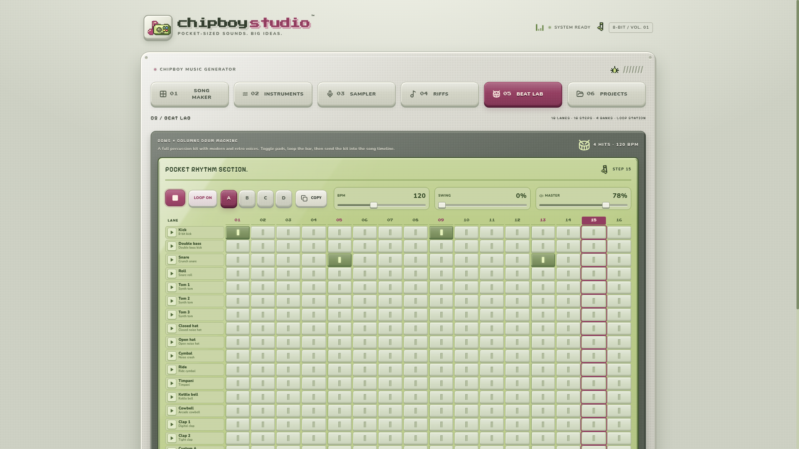

# Beat lab and FX rack

The **Beat lab** is a rows × columns drum machine and loop station. It is a fast sketchpad for rhythm: build a one-bar pattern, audition it, then send the active lanes into the song as individual channels.



The **FX rack** is the per-channel processor attached to every channel in the Pattern editor. It covers filtering, drive, distortion, bit depth, acid envelopes, modulation, delay, reverb, compression and three-band tone shaping.

## Quick start

1. Open **05 / BEAT LAB** in the workspace navigation.
2. Pick a bank: **A**, **B**, **C** or **D**.
3. Tap pads in the 18 × 16 grid. Columns are sixteenth notes; rows are drum lanes.
4. Press the play button, adjust **BPM** and **SWING**, then leave **LOOP** on for a repeating groove.
5. Press **SEND TO SONG**. Each active lane becomes a separate drum-kit channel with a one-bar block at the selected bar in the Song maker.
6. Open the Song maker, select a drum channel, and shape it with the FX rack.

The Beat lab is independent of the song until you send it. Its banks are stored in browser storage under `chipboy-studio.drum-machine.v1`.

## Lanes

| Lane | Sound | Default preset | Notes |
| --- | --- | --- | --- |
| Kick | 8-bit kick | `kick8` | Short pitch drop, the main anchor. |
| Double bass | Long kick | `doublekick` | Lower, longer decay for trap and drill patterns. |
| Snare | Crunch snare | `snare` | Noise-based backbeat. |
| Roll | Snare roll | `roll` | Short noise burst for rolls and fills. |
| Tom 1 | High tom | `tom` | Pitched lane. |
| Tom 2 | Mid tom | `tom` | Pitched lane. |
| Tom 3 | Low tom | `tom` | Pitched lane. |
| Closed hat | Closed noise hat | `hat` | Short high-passed noise. |
| Open hat | Open noise hat | `openhat` | Longer high-passed noise. |
| Cymbal | Noise crash | `crash` | Long wash for accents. |
| Ride | Ride cymbal | `ride` | Brighter, shorter cymbal. |
| Timpani | Timpani | `timpani` | Low orchestral drum with a long decay. |
| Kettle bell | Kettle bell | `kettlebell` | FM bell with a metallic edge. |
| Cowbell | Arcade cowbell | `cowbell` | FM cowbell for phonk and arcade parts. |
| Clap 1 | Digital clap | `clap` | Wide digital clap. |
| Clap 2 | Tight clap | `clap2` | Shorter, tighter clap. |
| Custom A | Any preset | `pulse50` | Load any preset from the instrument library. |
| Custom B | Any preset | `bell` | Load any preset from the instrument library. |

Toms 1–3 share the `tom` preset and differ by MIDI root. Custom A and B expose a preset selector in the lane header.

## Loop station controls

| Control | Behavior |
| --- | --- |
| Play / stop | Starts or stops the Web Audio look-ahead scheduler. |
| Loop | Repeats the 16-step bar. Turn it off to play one pass. |
| Banks A–D | Four independent 16-step patterns. Changing bank stops playback. |
| BPM | 40–240. The slider updates the running loop immediately. |
| Swing | 0–60%. Delays odd sixteenth notes for a shuffled feel. |
| Master | 0–100% preview level. This does not overwrite the song master. |
| Copy | Copies the current bank into the next bank and selects it. |
| Randomize | Fills the grid with a weighted, musical starting point. Kick step 1 is always on. |
| Clear bank | Clears every lane after a confirmation prompt. |
| New pattern | Resets the active bank without touching the others. |
| Lane play button | Auditions that lane with its current preset. |

## Send to song

**Send to song** converts every lane with at least one active pad into a separate `Track`:

- one channel per active lane;
- a one-bar block at the currently selected bar;
- the lane's preset and root note;
- the lane's default volume;
- a clean FX rack with effects enabled but all amounts at zero.

The song tempo is set to the Beat lab BPM. The song supports up to 32 channels; if the kit would exceed that limit, the action stops with a readable error instead of creating an invalid project.

Sending the same kit twice creates a second set of channels. Use **Undo** in the Song maker if that was not intended.

## FX rack

The rack is attached to the selected channel in the Pattern editor. Open **02 / PATTERN EDITOR** and scroll to **FX RACK**. Effects apply on the next note or playback pass.

| Group | Controls |
| --- | --- |
| Filter & drive | Cutoff, resonance, drive, distortion, saturation, bit depth, acid envelope, filter LFO depth and rate. |
| Modulation | Chorus, flanger, phaser, tremolo, auto pan and ring modulation. |
| Space & dynamics | Delay send, feedback, delay time, reverb and compression. |
| Tone | Low shelf, mid peak and high shelf, from −12 to +12 dB. |

The acid control adds a per-note resonant filter envelope inside the voice scheduler. The filter bus also raises resonance, so acid basslines keep their bite in live playback and WAV export.

### Presets

| Preset | Character |
| --- | --- |
| Clean | Reset to the neutral rack. |
| Crunch | Moderate drive and distortion with light compression. |
| Acid 303 | High resonance, strong filter envelope and a short delay. |
| Wide | Chorus, phaser, flanger and auto pan. |
| Dub | Long feedback delay, reverb and a darker filter. |
| Lo-fi | Low bit depth, saturation, a dark filter and compression. |
| Comp | Strong compression with a gentle tone tilt. |
| Space | Large reverb and a soft delay. |
| Destroy | Heavy distortion, drive and extreme bit reduction. |

Every rack has a final safety limiter. The limiter is always present, even when **FX OFF** is selected, so a loud channel cannot clip the destination.

## Persistence

The Beat lab stores its four banks, BPM, swing, loop flag, master level and active bank in `localStorage` under `chipboy-studio.drum-machine.v1`. Corrupt or partial data falls back to an empty machine instead of throwing.

The FX rack is part of each track and is saved with the project. Older project files without the new fields load with safe defaults.

## Limits and safety

- 18 lanes, 16 steps and 4 banks per machine.
- Song channels are capped at 32.
- All effect values are clamped in `normalizeEffects` before they reach the audio graph.
- Feedback is capped at 0.9, delay time at 4 beats, and cutoff at 60 Hz–20 kHz.
- The Beat lab uses one shared preview bus and disposes it when the workspace closes or playback stops.
- The scheduler uses a 120 ms look-ahead window and cleans up finished voices on every tick.

## Accessibility

- Every pad is a real button with an accessible label and `aria-pressed` state.
- The grid uses `role="grid"`, row headers and grid cells.
- Lane preview buttons have descriptive labels.
- The playhead is visible as an outline on the current column and step readout.
- The whole studio respects `prefers-reduced-motion`.

## Code map

- `src/lib/drum-machine.ts` — lane definitions, pattern operations, persistence and conversion to song tracks.
- `src/hooks/use-drum-machine.ts` — Web Audio look-ahead scheduler and lane preview.
- `src/components/DrumMachine.tsx` — Beat lab workspace.
- `src/components/EffectsRack.tsx` — FX rack controls and presets.
- `src/lib/effects.ts` — effect normalization, tail calculation and the Web Audio effect bus.
- `src/lib/audio-engine.ts` — per-note acid envelope and voice scheduling.

## Tests

```bash
pnpm test
```

The drum-machine tests cover lane completeness, pattern toggling and copying, song-track conversion, timing and storage recovery. The effects tests cover expanded defaults, clamping and backwards-compatible loading.
